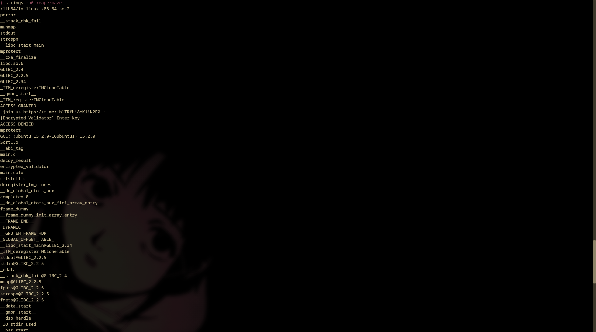
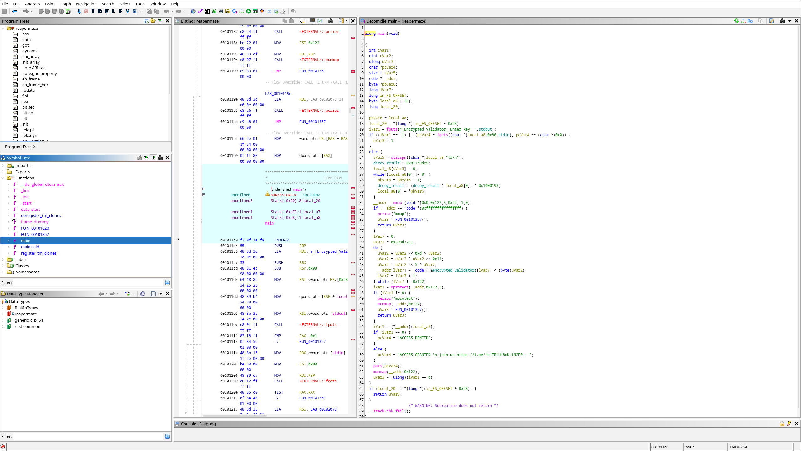
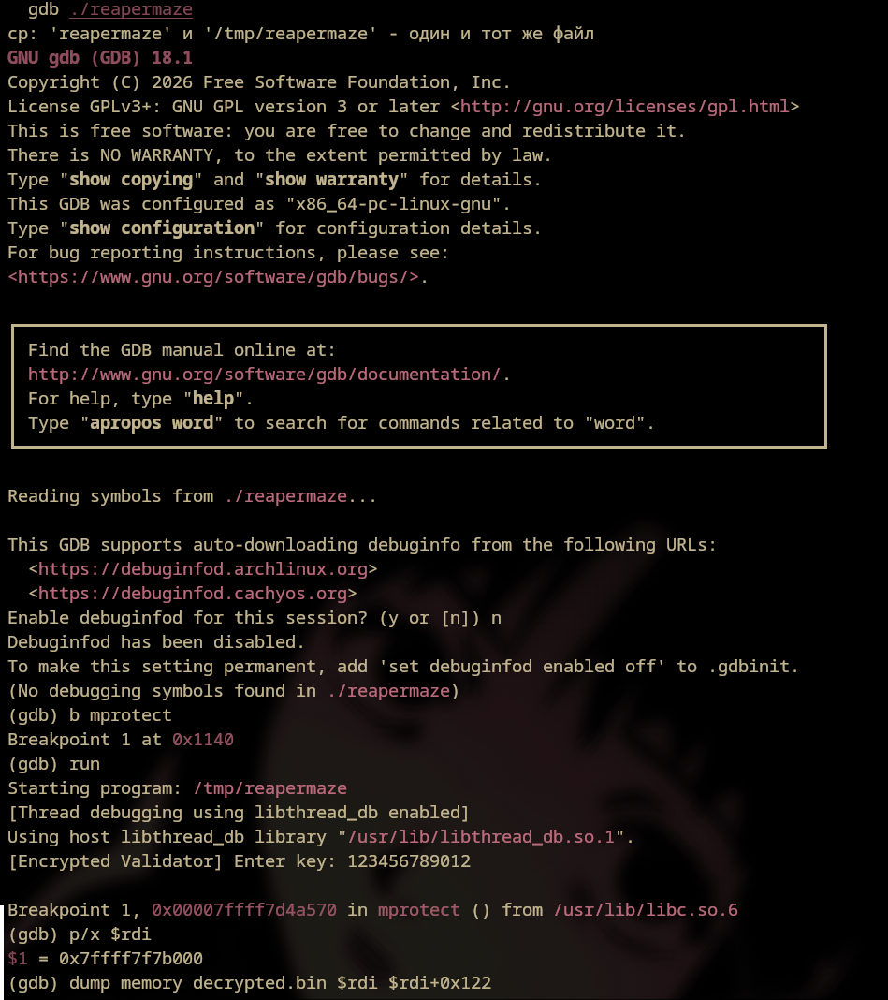
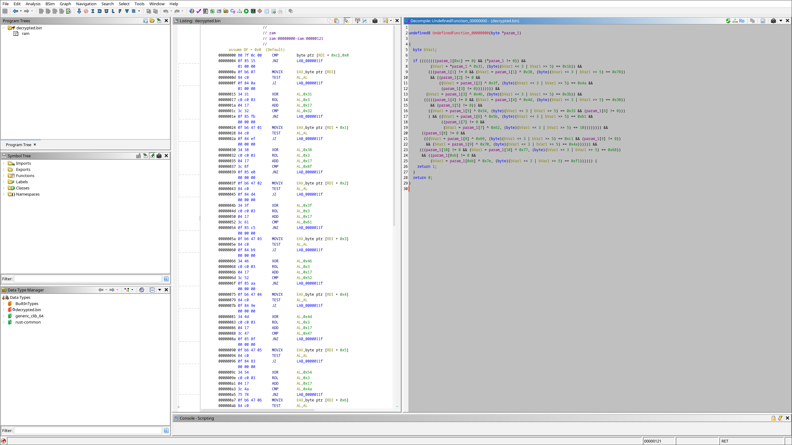
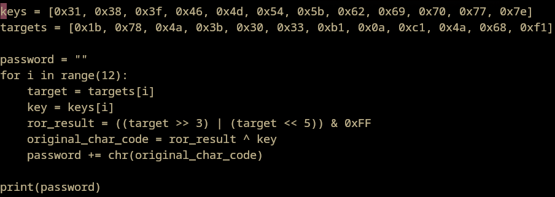
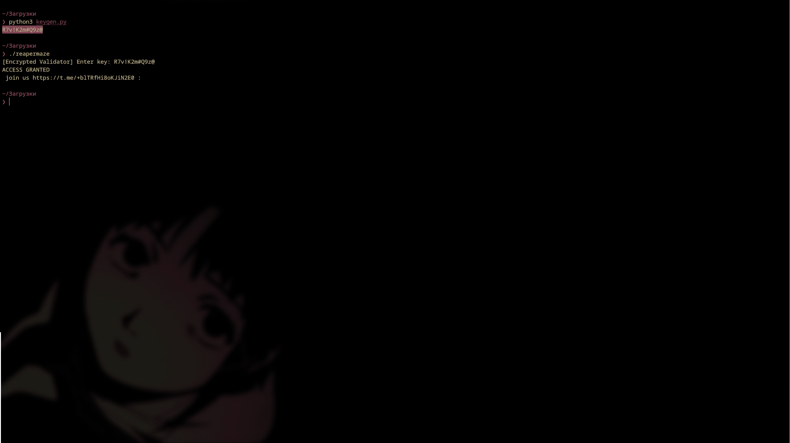

# REAPEMAZE (SoulReaper) — Writeup

**Metadata:**
* **Crackme Author:** SoulReaper
* **Platform:** Linux (x86-64)
* **Difficulty:** 5.0
* **Tools:** Ghidra, GDB, Python3
* **Goal:** Find the 12-character key (No patches, no bypasses).

## 1. Initial Reconnaissance
We run the binary. It prompts for a key. Using `strings`, we find important clues: `mprotect`, a suspicious `decoy_result` function, and an `encrypted_validator` array. This strongly hints at a hidden validator decrypted only in memory (Self-Modifying Code).



## 2. Static Analysis (Ghidra)
Opening the binary in Ghidra and navigating to `main`, we see a call to `encrypted_validator`. Inside, there is a classic unpacker pattern:
1. The bytes of the `encrypted_validator` array are XORed with a pseudo-random number in a loop.
2. `mprotect(__addr, 0x122, 5)` is called to grant execution permissions (Read + Execute).
3. A jump is made to the pointer `(*__addr)(local_a8)`.



## 3. Dynamic Analysis & Memory Dump (GDB)
Since the code is generated only in RAM, we cannot see it in Ghidra. We launch GDB, set a breakpoint on `mprotect`, and enter a test key.

When execution stops at `mprotect`, we check the decrypted memory address in the `$rdi` register and dump it to a file:
```gdb
dump memory decrypted.bin $rdi $rdi+0x122
```



## 4. Decrypted Code Analysis
We load the resulting `decrypted.bin` into Ghidra as a `Raw Binary` (architecture x86:LE:64:default). The decompiler reveals a validator that checks each character:
1. Takes the character and XORs it with a constant.
2. Performs a bitwise rotate left by 3 bits (`ROL 3`, which in C looks like `(bVar1 << 3 | bVar1 >> 5)`).
3. Compares the result with a target value.



## 5. Key Recovery (Keygen)
Knowing the algorithm, we write a reverse Python script (performing ROR 3 and XOR). The code is available in [keygen.py](./keygen.py).



We run the script, obtain the 12-character key, and verify it in the original binary:


