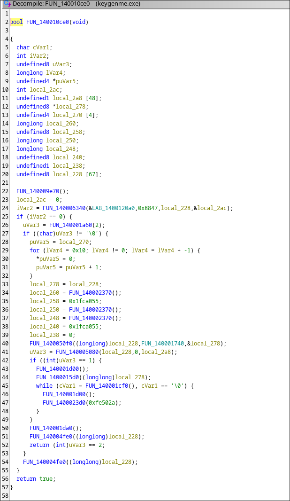
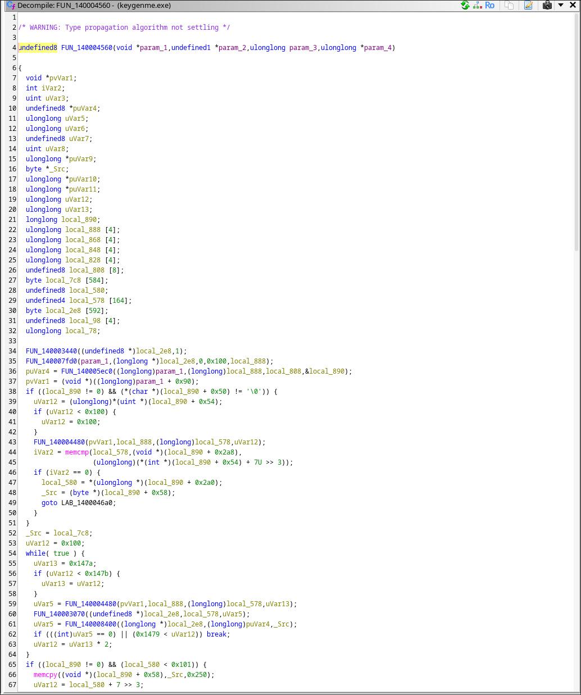
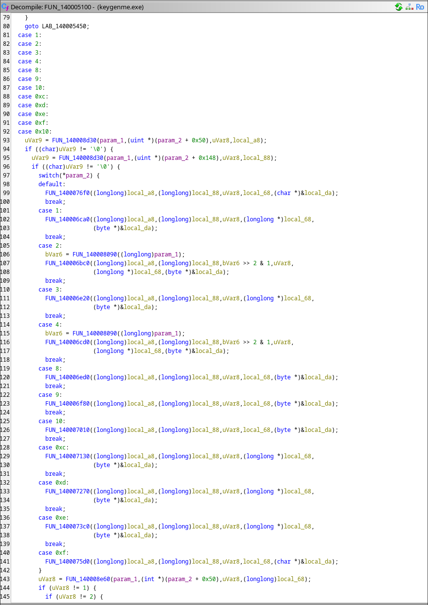
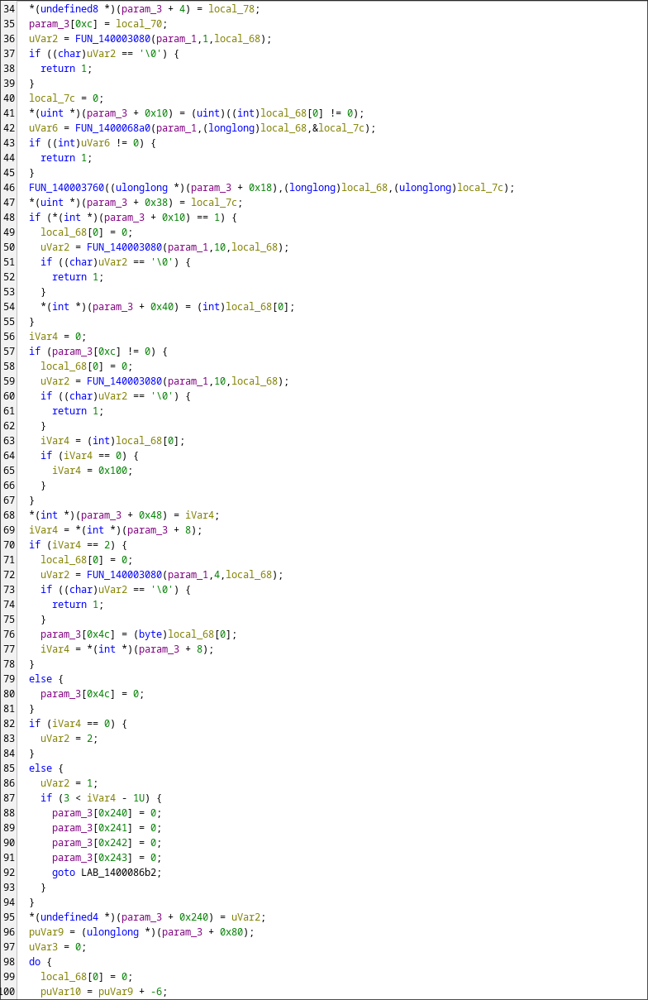
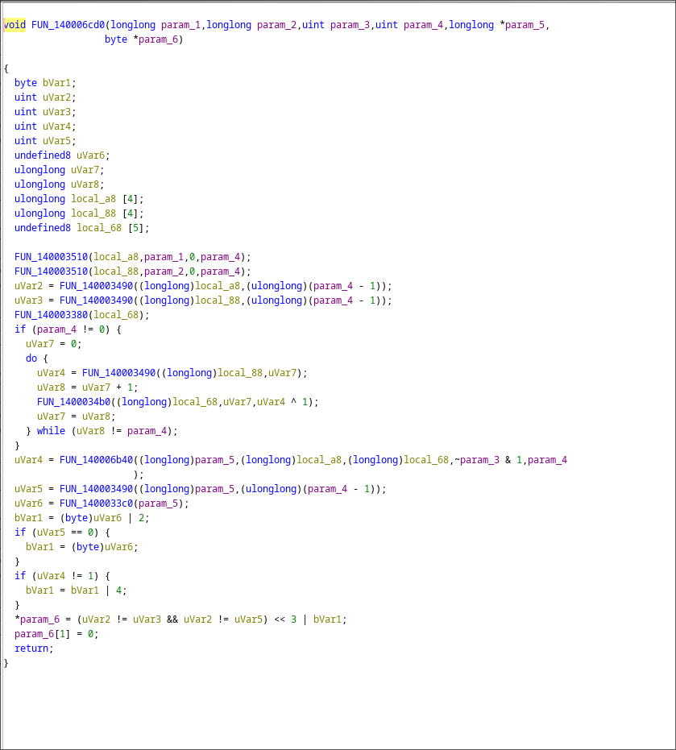

# Hard VM Keygenme (Exxtruder) — Writeup

**Metadata:**
* **Crackme Author:** Exxtruder
* **Platform:** Windows (x86-64)
* **Difficulty:** 5.0
* **Tools:** Ghidra, Wine

**Binary:** [keygenme.exe](./keygenme.exe) (Included in this folder for reproducibility)

## 1. Initial Reconnaissance
The binary is a Windows GUI application built with MinGW. The actual entry point is `WinMain` (`FUN_140010ce0`), which sets up the window class (`RegisterClassA`), creates the main window (`CreateWindowExA`), and enters the message loop. String searches yielded little results because the strings are obfuscated or generated dynamically.

## 2. Main Loop and VM Dispatcher
The core logic is located in the event handler (`FUN_140004560`). It processes user input, prepares the internal bytecode, and passes it to the Virtual Machine Dispatcher (`FUN_140005100`). The dispatcher contains a massive `switch(bVar6)` where `bVar6` acts as the VM's opcode.

## 3. VM Architecture
Analyzing the opcodes revealed the VM's parser and ALU:
*   **Parser (`FUN_140008400`):** Reads data in chunks (8, 1, 10 bytes) and populates the VM's internal state structure.
*   **ALU (`FUN_140006cd0`):** Performs subtraction by inverting bits (`^ 1`) and passing them to the addition function (`FUN_140006b40`), mimicking standard CPU behavior.

## Conclusion
The static analysis successfully mapped the custom VM's architecture: the event loop, bytecode parser, dispatcher, and ALU (ADD/SUB operations). 

## Methodology & AI Disclosure
*Note on AI usage:* As recommended by the crackme author, AI was used as an assistant tool to accelerate the comprehension of decompiled Ghidra output and to help map the VM's internal structures. All reverse engineering steps, code navigation, and architectural conclusions were verified manually.
